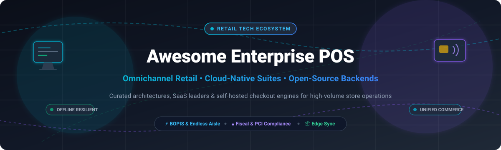

# 🛒 Awesome Enterprise Point Of Sale (POS)

  

  
  
  
  
  
  
  

> 🌟 A curated list of leading Enterprise Point of Sale (POS) software, SaaS omnichannel commerce suites, self-hosted retail backends, and open-source POS engines.

Enterprise Point of Sale (POS) systems orchestrate high-volume checkout, unified in-store and e-commerce inventory, store fulfillment (BOPIS, ship-from-store, endless aisle), customer relationship management, and complex tax/fiscal compliance across hundreds of retail chains and franchises.

---

## 📑 Table of Contents

- [📊 Sector Overview & Market Dynamics](#-sector-overview--market-dynamics)
- [🏢 Enterprise SaaS & Hosted Platforms](#-enterprise-saas--hosted-platforms)
- [💻 Open-Source Point of Sale Projects](#-open-source-point-of-sale-projects)
- [🏗️ Architectural Patterns in Enterprise POS](#️-architectural-patterns-in-enterprise-pos)
- [🤝 How to Contribute](#-how-to-contribute)
- [⭐ Star History](#-star-history)
- [💖 Support](#-support)
- [⚖️ Disclaimer & Compliance](#️-disclaimer--compliance)

---

## 📊 Sector Overview & Market Dynamics

The global Point of Sale (POS) software market is valued at approximately **$16.4B–$19.0B** (with total POS hardware and terminal ecosystems exceeding **$115B+**), compounding at roughly ~10% annually toward $40B+ by the early 2030s.

The market displays a distinct **bifurcated structure**: it is **moderately fragmented** across regional SMB merchants and independent restaurant/retail shops where thousands of ISVs and payment apps compete, yet **highly concentrated** at the Tier-1/Tier-2 enterprise level where a select group of legacy giants and unified commerce cloud vendors (Oracle, Shopify, Manhattan Associates, Diebold Nixdorf, NCR Voyix) capture the overwhelming majority of large enterprise deployments due to stringent global fiscalization, multi-lane hardware reliability, and complex ERP/OMS integrations.

---

## 🏢 Enterprise SaaS & Hosted Platforms

The following table compares leading commercial and SaaS enterprise POS platforms, ranked in descending order by parent company market capitalization / valuation.

| Product | 🏢 Company Valuation / Revenue | 💳 Starting Tier Pricing | 🎁 Free Tier / Trial Limit | 🚀 Key Capabilities & Architecture |
| :--- | :--- | :--- | :--- | :--- |
| **[Oracle Retail POS (Xstore)](https://www.oracle.com/retail/)** | **~$390B Market Cap** (~$53B annual rev) | Custom quote-based (starts ~$150–$300/lane/mo for core modules) | No free tier; demo upon request only | Enterprise tier-1 store POS; deep inventory cycle counts, till management, offline resilience, and Oracle Cloud Retail integration. |
| **[Shopify POS Pro](https://www.shopify.com/pos)** | **~$215B Market Cap** (~$8.8B annual rev) | $89/month per location (+ base Shopify subscription from $39/mo) | 3-day free trial + $1/month introductory promo for 3 months (POS Pro free on Shopify Plus up to 20 locations) | Unified commerce engine with mobile checkout, BOPIS, staff permissions, exchanges, and native omnichannel inventory sync. |
| **[Manhattan Active POS](https://www.manh.com/)** | **~$13.5B Market Cap** (~$1.1B annual rev) | Custom enterprise quote (tiered per-device/per-store SaaS subscription) | No free tier; guided pilot / interactive enterprise demo only | Cloud-native microservices architecture, continuous zero-downtime upgrades, clienteling, and store-as-fulfillment center routing. |
| **[Cegid Retail](https://www.cegid.com/)** | **~€5.5B Valuation** (~€852M annual rev) | Starts at €159/month per terminal | No free tier; custom proof-of-concept / sandbox upon inquiry | Worldwide retail/luxury leader; advanced clienteling, mobile-first iOS/Android checkout, and multi-country tax compliance. |
| **[Diebold Nixdorf Vynamic](https://www.dieboldnixdorf.com/)** | **~$2.2B Market Cap** (~$3.87B annual rev) | Custom enterprise quote (packaged per terminal + maintenance) | No free tier; managed proof-of-concept for qualified enterprise retail chains | Fuel/convenience, grocery, and specialty retail solutions; self-checkout (SCO) integration, smart vision produce recognition. |
| **[NCR Voyix Emerald](https://www.ncrvoyix.com/)** | **~$1.15B Market Cap** (~$2.5B annual rev) | Quote-based (entry tiers start ~$100–$175/terminal/mo + hardware) | No free tier; 30-day guided pilot available for enterprise evaluations | High-volume multi-lane supermarket and retail checkout; on-premise edge resiliency tightly paired with NCR Commerce Cloud. |
| **[Lightspeed Enterprise Retail](https://www.lightspeedhq.com/)** | **~$1.45B Market Cap** (~$1.1B annual rev) | $89/month (Basic) up to $289/month (Plus); Enterprise custom quoted | 14-day free trial (no credit card required; full access to retail inventory and POS registers) | Modern cloud POS with multi-store inventory matrices, supplier catalogs, B2B purchasing, and 250+ enterprise ecosystem integrations. |
| **[Toshiba Global Commerce Solutions](https://www.toshiba.com/)** | **~$800M+ Revenue** (Toshiba Tec Group ~$3.6B) | Custom enterprise quote (modular software license + TCx hardware) | No free tier; lab demonstration and hardware pilot testing upon request | TCx Sky OS and ELERA unified commerce platform; powers high-throughput grocery, pharmacy, and department store lanes. |
| **[Aptos Retail (Aptos ONE)](https://www.aptos.com/)** | **~$400M+ Revenue** (Goldman Sachs portfolio) | Custom quote-based (SaaS subscription structured per-store/month) | No free tier; tailored enterprise sandbox/demo environment | Mobile-first unified transaction engine, ship-from-store, endless aisle, and enterprise cycle counts deployed across global retail brands. |
| **[GK Software (CLOUD4RETAIL)](https://www.gk-software.com/)** | **~€194M Revenue** (Wholly-owned Fujitsu subsidiary) | Custom enterprise quote (CLOUD4RETAIL); SMB tier RETAIL7 starts €49/mo | No free tier on CLOUD4RETAIL; RETAIL7 offers 14-day free trial | Hardware-independent POS deployed across 69+ countries, 400+ open APIs, AI-driven dynamic pricing, and fiscal compliance. |

---

## 💻 Open-Source Point of Sale Projects

Open-source POS engines, modular ERP frameworks, and self-hosted POS applications ranked by GitHub stargazers count (descending):

| Repository | ⭐ GitHub_Stars | 🛠️ Technology Stack | 🎯 Best Suited For |
| :--- | :--- | :--- | :--- |
| **[Odoo POS](https://github.com/odoo/odoo)** |  | Python, JavaScript, PostgreSQL | Modular ERP & web-first touchscreen POS for retail shops, restaurants, and hospitality chains. Supports offline orders and IoT hardware boxes. |
| **[ERPNext POS](https://github.com/frappe/erpnext)** |  | Python, Frappe Framework, MariaDB | Full-suite open-source ERP with integrated retail POS, inventory serial/batch tracking, billing, multi-store accounting, and barcode scanning. |
| **[BTCPay Server](https://github.com/btcpayserver/btcpayserver)** |  | C#, .NET, ASP.NET Core | Self-hosted, censorship-resistant point-of-sale terminal and cryptocurrency payment gateway with invoice generation and zero intermediary fees. |
| **[OSPOS (Open Source Point of Sale)](https://github.com/opensourcepos/opensourcepos)** |  | PHP, CodeIgniter, MySQL, Bootstrap | Lightweight, battle-tested web-based POS for small-to-medium retailers. Includes barcode generation, stock management, customer invoicing, and reports. |
| **[NexoPOS](https://github.com/Blair2004/NexoPOS)** |  | PHP, Laravel, Vue.js, Tailwind CSS | Contemporary, extendable web POS system with multi-store inventory management, order processing, customer accounts, and modular add-on support. |
| **[Store-POS](https://github.com/tngoman/Store-POS)** |  | Electron, React, Node.js, SQLite | Modern cross-platform desktop POS till with LAN multi-terminal sync, barcode catalog, cash management, and Windows installer. |
| **[Lakasir](https://github.com/lakasir/lakasir)** |  | JavaScript, Vue.js, PWA | Lightweight progressive web application (PWA) POS designed for fast cashier workflows and accessible offline-first operation. |
| **[TailPOS](https://github.com/bailabs/tailpos)** |  | Python, Kivy, ERPNext Integration | Offline-first mobile and desktop POS designed specifically to pair with ERPNext instances, enabling resilient retail checkouts. |
| **[POS Awesome](https://github.com/ucraft-com/POS-Awesome)** |  | Vue.js, Vuetify, ERPNext | Enhanced single-page POS UI add-on for ERPNext featuring offline caching, split payments, barcode scanner shortcuts, and quick checkout. |
| **[Laravel POS](https://github.com/angkosal/laravel-pos)** |  | PHP, Laravel, Bootstrap, MySQL | Clean reference web POS implementation covering product cataloging, order receipt printing, and daily transaction logs. |
| **[React Point of Sale](https://github.com/shanmugharajk/react-point-of-sale)** |  | JavaScript, React, Node.js, Express, MongoDB | Full-stack JavaScript Point of Sale application featuring responsive cash register layouts, receipt generation, and real-time order states. |
| **[Go POS](https://github.com/bagashiz/go-pos)** |  | Go, Gin, PostgreSQL, Redis | High-performance RESTful POS microservice backend architected around Hexagonal Architecture principles and caching. |

---

## 🏗️ Architectural Patterns in Enterprise POS

When designing or evaluating enterprise-grade POS systems, several core architectural patterns separate simple cash registers from enterprise-ready checkout platforms:

1. **🔄 Offline Resiliency & Cursor-Based Sync**: Stores cannot halt sales when wide-area networks (WAN) experience latency or outages. Production POS architectures employ local persistent storage (e.g., SQLite, IndexedDB, or embedded Couchbase/PostgreSQL) with deterministic, idempotent pull/push synchronization queues once connectivity restores.
2. **📒 Double-Entry Immutable Ledgers**: High-volume retail checkout requires tamper-evident tracking of shift balances, cash drawer drops, split tenders, and refund audits using double-entry ledger designs.
3. **🔌 Hardware Abstraction Layer (HAL)**: Abstracting thermal receipt printers (ESC/POS), line customer displays, scale weighers, cash drawers, and EMV payment PIN pads across disparate OS environments (iOS mPOS tablets, Android handhelds, Windows touch terminals).
4. **🌐 Unified Omnichannel Inventory**: Bridging brick-and-mortar stock with digital fulfillment routes—enabling Buy Online, Pick Up In Store (BOPIS), Ship-from-Store (SFS), and Endless Aisle dropshipping without double-allocation risks.
5. **🛡️ Fiscalization & Compliance Engine**: Integrating local fiscal hardware units, electronic signature validation, e-invoicing authorities, PCI-DSS payment data segmentation, and GDPR/CCPA data minimization.

---

## 🤝 How to Contribute

Contributions, corrections, and additions are welcome!

1. 🍴 Fork this repository.
2. 🌿 Create a new branch: `git checkout -b feature/new-pos-platform`.
3. 📝 Add or update items in `README.md` adhering to existing table formats and alphabetical/star ordering.
4. 🔗 Ensure valid URLs and factual pricing/architecture details.
5. 🚀 Submit a Pull Request with a clear summary of your changes.

---

##  Star History

---

## 💖 Support

Thank you for exploring this curated repository! If you find this resource helpful for your research, team, or retail projects, please consider:
- ⭐ **Starring** the repository on GitHub
- 🍴 **Forking** it to keep your own copy or suggest updates
- 📢 **Sharing** it with retail CIOs, architects, and commerce engineers
- ☕ **Supporting the creator** via the [GitHub Sponsors Dashboard](https://github.com/sponsors/ishandutta2007)

---

## ⚖️ Disclaimer & Compliance

- This repository is an independent community curation and is not affiliated with or sponsored by any listed POS vendors.
- Any point-of-sale software handling cardholder payment data must comply with **PCI DSS** (Payment Card Industry Data Security Standards). Self-hosted platforms require proper network segmentation, Point-to-Point Encryption (P2PE), and validated payment terminals.
- Check licenses prior to commercial deployment: Odoo Community is licensed under LGPL-3.0 (with Enterprise requiring commercial subscriptions), ERPNext is GPL-3.0, and various backend references use MIT/Apache-2.0.
